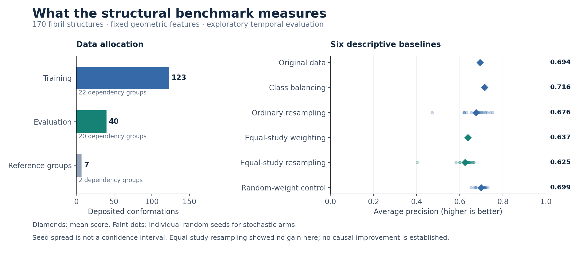
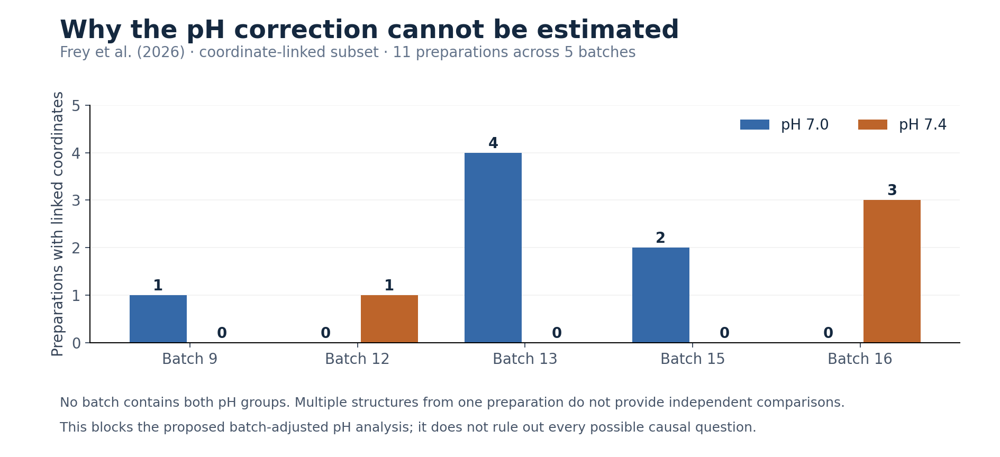

# reaSyn

Resampling alpha-synuclein structural ensembles from the [Amyloid Atlas](https://people.mbi.ucla.edu/sawaya/amyloidatlas/) and PDB.

The workflow validates frozen inputs, measures backbone similarity, freezes dependency-aware temporal splits, runs six descriptive model baselines, exports capped resampling draws and reports uncertainty. The causal estimator is tested on synthetic confounding. Real-data causal correction remains unavailable because a defensible causal design and sufficient independent-sample metadata have not been established.

## Results at a glance



Results at the prespecified 0.5 similarity cutoff. Diamonds show mean average precision; faint dots show individual random seeds for stochastic arms. Equal-study resampling scored 0.625 versus 0.694 for original data. These are exploratory results from the same Atlas snapshot, not evidence of improved causal generalisation. Seed variation is not a confidence interval.



The coordinate-linked subset from [Frey et al. (2026)](https://doi.org/10.7554/eLife.112692.1) contains 11 preparations for this contrast. No within-batch pH comparison is available, preventing the proposed batch-adjusted correction.

Figures are generated from saved results by [plot_fibril_readme.ipynb](notebooks/plot_fibril_readme.ipynb), using Matplotlib 3.10.8 (`.venv/bin/python -m pip install matplotlib==3.10.8`). Run its cells in order with the local data present to regenerate the images. [Figure provenance](docs/images/figure_provenance.json) records input checksums, run IDs and plotted values.

## Run

Use Python 3.14 and the existing downloaded data:

```sh
python3 -m venv .venv
.venv/bin/python -m pip install -r requirements-analysis.txt
make test
make analyse
make notebook
```

Open `notebooks/analyse_fibril_structures.ipynb` for the results. Shared numerical code lives in `reasyn/` so notebooks, the command-line workflow and tests use the same implementation.

Configuration is in `config/fibril_analysis.json`. Results are written to `data/analysis/<run-id>/report.md` with metadata, similarities, frozen splits, model coefficients, predictions, resampling rows and diagnostics. Completed runs verify output checksums before reuse. The primary threshold and temporal boundary are exploratory defaults recorded before fitting. Do not tune them against reported test results and continue to call that test independent.

## Container

```sh
docker build -f Dockerfile.analysis -t reasyn-analysis .
docker run --rm --network none -v "$PWD/data:/workspace/data" -v "$PWD/data/raw:/workspace/data/raw:ro" reasyn-analysis
docker run --rm --network none reasyn-analysis python -m pytest -q
```

## Inputs

The acquisition and inclusion-review notebooks remain the source workflow. `make download-fibril-structures` downloads coordinates and structured metadata. Review decisions, publication source files and the matching curation export are also required before analysis. The runner fails on missing, altered or stale inputs; it does not manufacture curation on a fresh checkout. All data are intentionally ignored by Git. Preserve your local `data/` directory or a separate archive when moving machines.

Publication metadata retain their original review status. Rerun `curate_fibril_metadata.ipynb` after intentional curation edits. Original sources and earlier exports remain intact. New downloads should enter a separate snapshot and must not alter a frozen test set.

## Interpretation

The real-data causal assessment is in `notebooks/assess_fibril_causal_overlap.ipynb`; run it with `make causal-overlap` using the existing analysis container and cached publication tables. It links 22 conformations to 13 preparations from Frey et al. (2026), reconciles an accession discrepancy through EMDB identifiers and leaves one unresolved mapping excluded. For the pH 7.0 versus 7.4 contrast, 11 preparations span five batches but every batch has only one exposure level. The proposed batch-adjusted causal effect is therefore not identifiable from this coordinate-linked subset. The notebook computes this diagnosis from sample-level records and exports the evidence under `data/causal/`. It does not replace the frozen prediction benchmark or claim that all possible causal questions have been ruled out.

The current target is resemblance to selected patient-derived backbones, not disease prediction. It omits protofilament interfaces. The temporal evaluation cohort comes from the same Atlas snapshot; independent external validation is outstanding. Equal-study weighting and resampling are descriptive baselines and must not be described as causal correction.

See [the protocol](docs/fibril_method.md) for assumptions, the proposed causal graph, sampling probabilities and limitations. Original researchers receive credit for coordinates and experimental evidence; reaSyn contributes processing, resampling and evaluation. This workflow performs no publication or coordinate generation.
