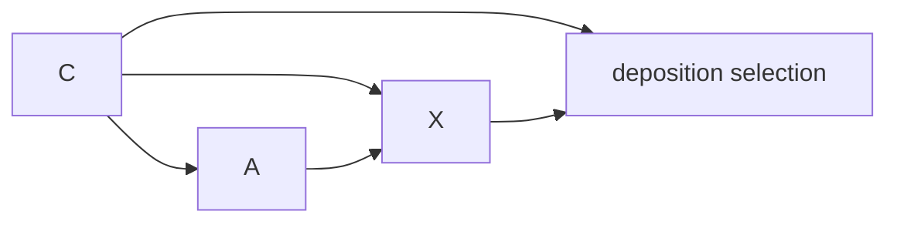

# Structural analysis protocol

The runnable workflow is an exploratory structural benchmark. It is not evidence of causal correction or a patient diagnostic. The initial 170-entry inclusion review and all original downloads remain frozen. Publication curation remains incomplete and its review status is retained.

The unit is a deposited conformation. A study is a conservative source unit because independent preparation identifiers are generally unavailable. Repeated chains are not independent samples. Original coordinates remain unchanged and every sampled row identifies its original mmCIF, checksum, study, unresolved sample ID and source licence.

## Structural observations

The analysis uses model 1 alpha-synuclein C-alpha atoms, chooses the highest occupancy alternate (lexical tie break), and rejects insertion codes or author numbering outside 1–140 pending explicit mapping. Missing residues remain missing. Coordinates are in angstroms. Author numbering within this range is provisionally treated as homologous; unflagged renumbering is a remaining limitation.

Each distinct backbone is compared using author-residue correspondence and a proper Kabsch rotation. The score sums `1 / (1 + (distance / d0)^2)` over matched residues and divides by the larger ordered-chain length, where `d0 = max(0.5, 1.24 * cbrt(length - 15) - 1.8)`. At least 30 common residues are required. This is a residue-matched similarity score, not a TM-align result. The best chain pair is retained with coverage and RMSD. It measures backbone resemblance and omits protofilament packing, strand registry alternatives and cofactors. Near-identical symmetry copies are collapsed only within an entry.

Reference structures are 6XYO, 6XYP and 6XYQ ([Schweighauser et al.](https://doi.org/10.1038/s41586-020-2317-6)), and 8A9L ([Yang et al.](https://doi.org/10.1038/s41586-022-05319-3)). A score of 0.5 is the provisional primary threshold, with 0.45 and 0.55 reported without selecting the most favourable outcome. This defines reference resemblance rather than clinical status. This deliberately narrower endpoint avoids automatically assigning positive labels to new patient structures with unrelated folds.

## Dependencies and evaluation

Connected components join shared studies, backbone scores at least 0.95, and recorded starting-model dependencies. Components containing references are excluded from prediction training and evaluation. A component enters the temporal evaluation cohort only if every member was released on or after 1 January 2024. This conservative rule prevents a recent duplicate of an old training entry from becoming a test case. All other eligible components train the model.

This cohort is a holdout from the same Atlas snapshot. It is not a verified independent external dataset. Unknown shared samples, restraints, laboratories and upstream fitting remain limitations. A single class in either partition results in an explicit unavailable evaluation, not a new split selected to improve scores.

Features are mean chain geometry: ordered length, radius of gyration, span, end-to-end distance, nonlocal contact density, principal-axis fraction and planarity. Reference scores and origin metadata are excluded from predictors. Scaling is fitted on original training data only. All arms use the same logistic model, C=1, and optimisation budget. There is no hyperparameter search. Baselines are original data, class balancing, ordinary capped resampling, equal-study weighted loss, equal-study capped resampling and random study weights. The latter three are descriptive controls, not causal adjustments. Draw variation and dependency-group bootstrap intervals are recorded separately. Small numbers of evaluation groups suppress confidence intervals.

## Causal eligibility

X denotes structural observations. A must be an agreed pre-structure condition; C must contain measured causes of both A and X. A possible back-door hypothesis is:

Observing only S=1 does not identify deposition probabilities. Resolution may depend on structure and measurement, and a similarity-derived label is a consequence of X; neither is automatically a confounder. No causal A, C or target distribution has been established for this dataset. The real-data causal arms therefore remain unavailable. The reusable categorical estimator implements P(A)/P(A|C) at an independently justified sample level, rejects insufficient overlap and is tested on a planted-confounding example. Passing that test does not validate this graph for fibrils.

## Sampling and release

Sampling first selects a study, then a conformation within it. No population weights are available, so within-study selection is uniform. A copy cap changes conditional probabilities as items become unavailable: both initial and per-draw conditional probabilities are recorded. These are not claimed to be marginal inclusion probabilities under capped sampling. Study weights are renormalised across studies with remaining capacity. Coordinates are never generated.

Outputs live under `data/analysis/<content-hash>/`. A protocol is written before fitting and includes code, input and environment hashes. Completed runs validate every output checksum before reuse. No raw files are overwritten. Publication, domain review and an external evaluation dataset remain outstanding scientific steps; software execution cannot supply them.
